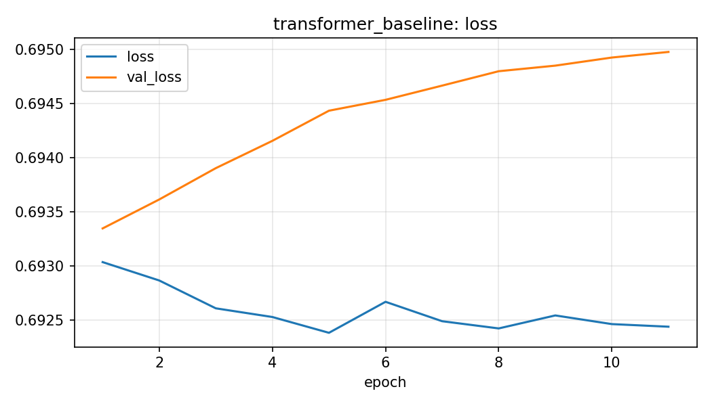
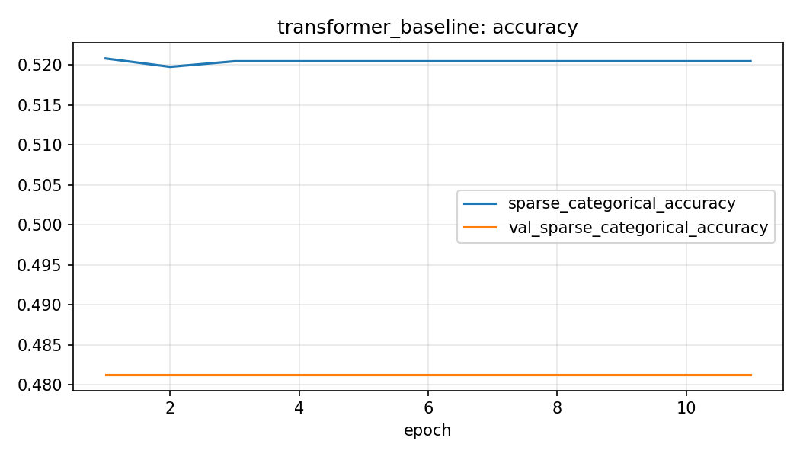

# Keras Time-Series Benchmark: Transformer Classification & LSTM Forecasting

CMPE 401 — Instructor-defined Project 2

This project reproduces, organizes, and extends two official Keras time-series examples:

| | Task | Dataset | Model | Notebook |
|---|---|---|---|---|
| 1 | Classification | FordA (engine sensor) | Transformer encoder | [](https://colab.research.google.com/github/river-kris/Keras-Timeseries/blob/main/notebooks/01_transformer_classification.ipynb) |
| 2 | Forecasting | Jena Climate (weather) | LSTM | [](https://colab.research.google.com/github/river-kris/Keras-Timeseries/blob/main/notebooks/02_lstm_weather_forecasting.ipynb) |

> **TL;DR of findings:** _TODO: 2–3 sentences once results are in._

---

## Table of contents
1. [Objective](#1-objective)
2. [Datasets](#2-datasets)
3. [Models](#3-models)
4. [Repository structure](#4-repository-structure)
5. [How to run](#5-how-to-run)
6. [Baseline reproduction (Task 1)](#6-baseline-reproduction-task-1)
7. [Improvements (Task 2)](#7-improvements-task-2)
8. [Benchmark summary (Task 3)](#8-benchmark-summary-task-3)
9. [Questions (Task 4)](#9-questions-task-4)
10. [Team contributions](#10-team-contributions)
11. [References](#11-references)

---

## 1. Objective
- Understand the difference between time-series **classification** (one label per sequence) and **forecasting** (predict a future value).
- Understand the difference between a **Transformer** (self-attention over all time steps at once) and an **LSTM** (recurrent, step-by-step hidden state).
- Reproduce both official baselines, make at least three controlled changes to one of them, and summarize the results as a benchmark.

## 2. Datasets

### FordA (classification)
- _TODO: source (UCR archive), what one sample is (500 time steps of engine noise), 2 classes (fault / no fault), train/test sizes, class balance._

### Jena Climate 2009–2016 (forecasting)
- _TODO: 14 features recorded every 10 minutes; 7 features used; target = temperature 12 h ahead; train/val split 71.5% / 28.5%; normalization._

## 3. Models

### Transformer encoder classifier
| | |
|---|---|
| Input | `(500, 1)` univariate sequence |
| Architecture | 4 × [Multi-head attention (4 heads, head size 256) → Dropout → LayerNorm → residual → Conv1D FFN → LayerNorm → residual] → GlobalAveragePooling → Dense(128) → Dropout(0.4) → Dense(2, softmax) |
| Loss / metric | Sparse categorical cross-entropy / accuracy |
| Training | Adam lr = 1e-4, batch 64, up to 150 epochs, early stopping (patience 10) |

### LSTM forecaster
| | |
|---|---|
| Input | `(120, 7)`: 120 hourly steps (past 720 records, sampled every 6) × 7 features |
| Architecture | LSTM(32) → Dense(1) |
| Output | Normalized temperature 72 records (12 h) after the input window |
| Loss / metric | MSE / MAE |
| Training | Adam lr = 1e-3, batch 256, 10 epochs, early stopping (patience 5), best-checkpoint |

_TODO: one paragraph on how the two models differ in the way they process the sequence._

## 4. Repository structure
```
.
├── notebooks/
│   ├── 01_transformer_classification.ipynb   # FordA + Transformer (baseline & experiments)
│   └── 02_lstm_weather_forecasting.ipynb     # Jena Climate + LSTM (baseline & experiments)
├── results/
│   └── <run_name>/                           # one folder per training run
│       ├── config.json                       # hyperparameters used
│       ├── metrics.json                      # final metrics, epochs, params, train time
│       ├── history.csv                       # per-epoch loss/metrics
│       ├── model.weights.h5                  # trained weights
│       └── *.png                             # loss/accuracy curves, predictions
├── figures/                                  # figures used in this README
├── scripts/
│   └── collect_results.py                    # builds the benchmark tables from results/
├── requirements.txt
└── README.md
```

## 5. How to run

### Google Colab (recommended)
1. Click an **Open in Colab** badge above.
2. `Runtime > Change runtime type > T4 GPU`.
3. Leave `CONFIG` at its defaults for the baseline, or change one hyperparameter and set a new `RUN_NAME` for an experiment.
4. `Runtime > Run all`. The final cell downloads `<RUN_NAME>.zip`.
5. Unzip it into `results/` so you get `results/<RUN_NAME>/...`, then commit.

### Build the benchmark tables
```bash
python scripts/collect_results.py --csv
```

### Local (optional)
```bash
pip install -r requirements.txt
jupyter notebook notebooks/
```

### Reproducing trained models
Every run is seeded (`seed = 42`) and its exact hyperparameters are stored in `results/<run>/config.json`. Copy them into the notebook's `CONFIG` to retrain, or load `model.weights.h5` into the model built by the notebook.

## 6. Baseline reproduction (Task 1)

Both baselines were run unchanged (official hyperparameters, `seed = 42`) on Google Colab with a Tesla T4, TensorFlow 2.21.0 / Keras 3.13.2.

| Model | Metric | Official example | Ours | Epochs (best / run) | Params | Train time |
|---|---|---|---|---|---|---|
| Transformer (FordA) | Test accuracy | ~0.85 (val ~0.84, 110–120 epochs) | **0.516** | 1 / 11 (early stop) | 29,258 | 3.5 min |
| LSTM (Jena) | Val MSE (normalized) | not stated | **0.1317** | 10 / 10 | 5,153 | 9.1 min |
| LSTM (Jena) | Val MAE | — | 0.285 normalized ≈ **2.46 °C** | | | |

### Transformer: the baseline did not reproduce

| | |
|---|---|
|  |  |

- Training loss stayed at ≈ 0.693 (= ln 2, the loss of a random 2-class guess) and training accuracy stayed at 52%, the share of the majority class.
- Validation loss rose slightly from epoch 1, so early stopping (patience 10) ended training after 11 epochs and restored the epoch-1 weights.
- On the test set the model predicts **class 0 for every sample** (confusion matrix `[[681, 0], [639, 0]]`), giving 51.6% accuracy, which is chance level.
- Our code is identical to the [official source](https://github.com/keras-team/keras-io/blob/master/examples/timeseries/timeseries_classification_transformer.py), so this is not a copying error.

**Likely cause (our analysis; not verified with a separate diagnostic run):** FordA has a single input channel, so every tensor inside the encoder has feature size 1. `LayerNormalization` normalizes over the feature axis, and normalizing a single value always gives 0, so each LayerNorm outputs only its learned bias β, a constant. As a result, the attention branch and the feed-forward branch each add just a constant to the residual stream, and each encoder block computes `inputs + constant`. After `GlobalAveragePooling1D`, the classifier head sees only the mean of the series plus a constant. FordA series are z-normalized (mean ≈ 0), so that input carries no class information, and the model can only learn the class prior. That is exactly what we observe.

### LSTM: reproduced

| | |
|---|---|
|  |  |

- Training ran all 10 epochs. The best validation loss came at the **last** epoch (0.1317), and validation loss was still falling (0.1390 → 0.1362 → 0.1317 over epochs 8–10), so the baseline is probably **under-trained**.
- Training MSE (0.0999) is below validation MSE (0.1317). Part of that gap is expected because validation covers different years and seasons than training.
- Validation MAE of 0.285 (normalized) is about **2.5 °C** average error when predicting temperature 12 hours ahead.
- Validation loss was noisy in the first epochs (it rose during epochs 3–4) before improving steadily.
- Note that the example has no separate test set; all LSTM numbers are on the validation split.

## 7. Improvements (Task 2)
**Chosen model: LSTM (Jena Climate forecasting).** The LSTM baseline reproduced correctly, so changes to it can be compared against a working reference. Each run also takes only about 5–15 minutes on a T4. The Transformer baseline did not learn at all (see Section 6), so comparing hyperparameters on it would just compare one chance-level model with another.

Each experiment changes **one** setting from the baseline. Everything else stays fixed: seed 42, the same data split, the same 7 features, 10 epochs, and early stopping with patience 5. All runs therefore get the same training budget, so a model that learns faster is rewarded. This is worth remembering because the baseline was still improving at epoch 10.

| # | Run | Change | Hypothesis | Val MSE | Val MAE (°C) | Δ MSE vs. baseline | Params | Time |
|---|---|---|---|---|---|---|---|---|
| 0 | `lstm_baseline` | — | — | 0.1317 | 2.46 | — | 5,153 | 9.1 min |
| 1 | `lstm_units64` | `lstm_units: 32 → 64` | More capacity per step should fit temperature dynamics better | _TODO_ | _TODO_ | _TODO_ | _TODO_ | _TODO_ |
| 2 | `lstm_stacked2` | `num_lstm_layers: 1 → 2` | A second layer can learn longer-range / more abstract patterns | _TODO_ | _TODO_ | _TODO_ | _TODO_ | _TODO_ |
| 3 | `lstm_past360` | `past: 720 → 360` (5 → 2.5 days of input) | Recent hours matter most for a 12 h forecast, so a shorter window may lose little and train faster | _TODO_ | _TODO_ | _TODO_ | _TODO_ | _TODO_ |

## 8. Benchmark summary (Task 3)
_Paste the output of `python scripts/collect_results.py` here._

**Key findings**
- _TODO_
- _TODO_
- _TODO_

**Limitations**
- _TODO (single seed, short training for LSTM, no separate LSTM test set, Colab GPU variability, ...)._

## 9. Questions (Task 4)

**Which model did you find easier to understand and why?**
_TODO_

**What improvement did you try, and what did you learn from it?**
_TODO_

## 10. Team contributions
| Member | Contributions |
|---|---|
| _TODO_ | _TODO_ |

## 11. References
- T. Ntakouris, *Timeseries classification with a Transformer model*, Keras examples. https://keras.io/examples/timeseries/timeseries_classification_transformer/
- P. Attri, Y. Sharma, K. Takach, F. Shah, *Timeseries forecasting for weather prediction*, Keras examples. https://keras.io/examples/timeseries/timeseries_weather_forecasting/
- A. Vaswani et al., *Attention Is All You Need*, NeurIPS 2017.
- S. Hochreiter, J. Schmidhuber, *Long Short-Term Memory*, Neural Computation, 1997.
- FordA dataset, UCR Time Series Classification Archive.
- Jena Climate dataset, Max Planck Institute for Biogeochemistry.
