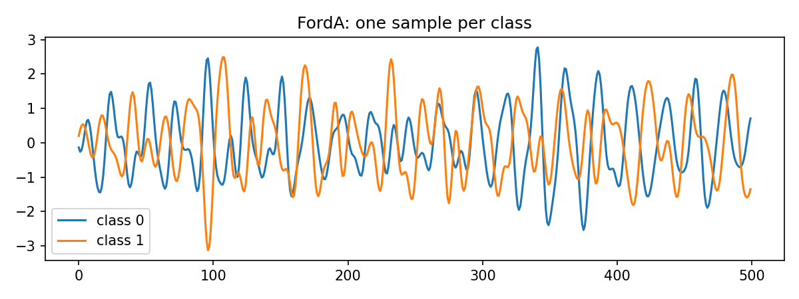
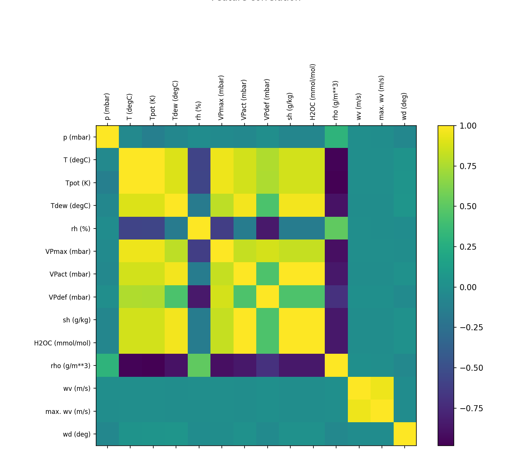
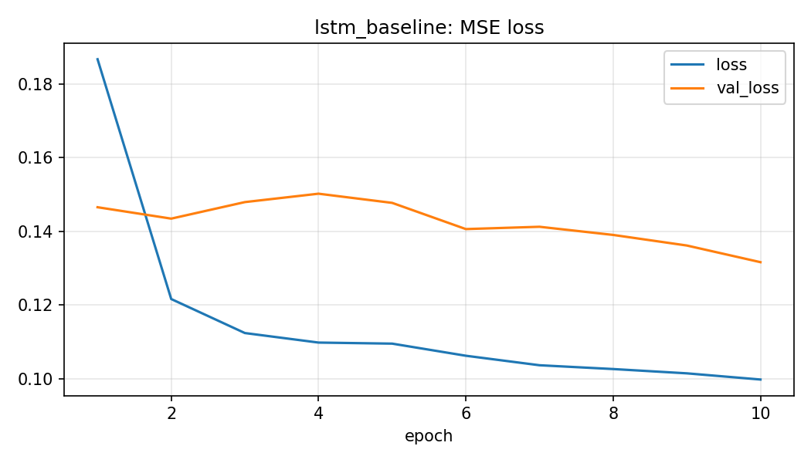
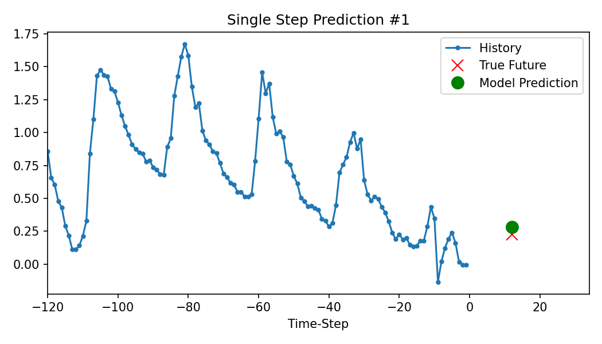
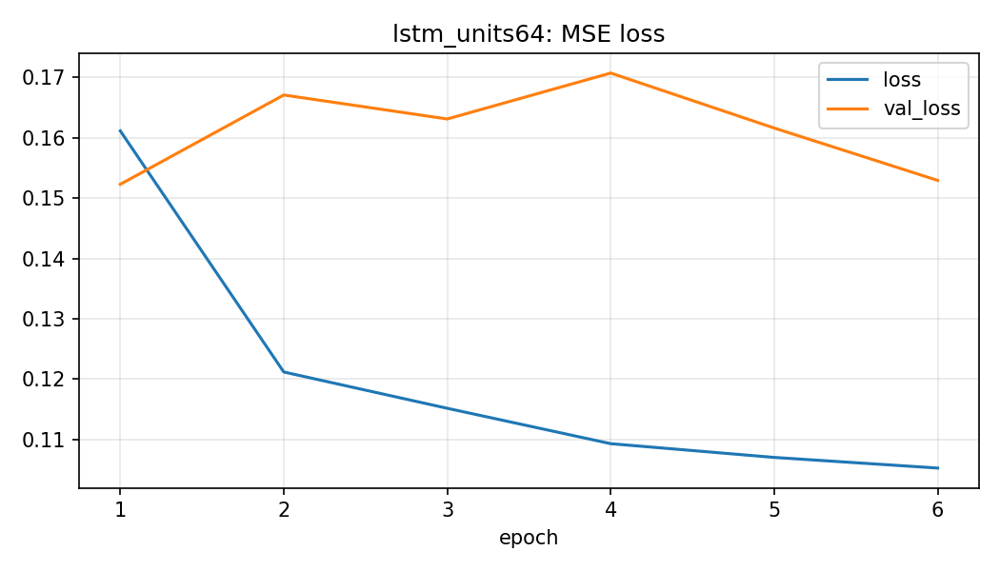
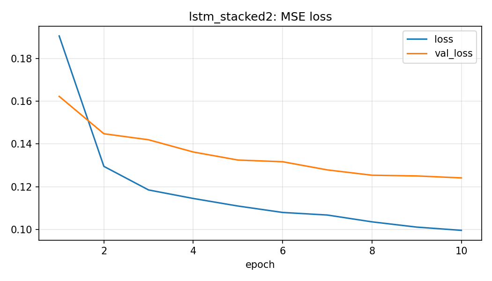
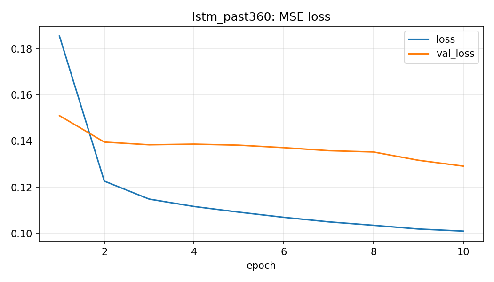

# Keras Time-Series Benchmark: Transformer Classification & LSTM Forecasting

CMPE 401 — Instructor-defined Project 2

This project reproduces, organizes, and extends two official Keras time-series examples:

| | Task | Dataset | Model | Notebook |
|---|---|---|---|---|
| 1 | Classification | FordA (engine sensor) | Transformer encoder | [](https://colab.research.google.com/github/river-kris/Keras-Timeseries/blob/main/notebooks/01_transformer_classification.ipynb) |
| 2 | Forecasting | Jena Climate (weather) | LSTM | [](https://colab.research.google.com/github/river-kris/Keras-Timeseries/blob/main/notebooks/02_lstm_weather_forecasting.ipynb) |

> **TL;DR of findings:** The LSTM forecasting baseline reproduced: it predicts temperature 12 h ahead with about 2.46 °C validation MAE. Of three controlled changes, **stacking a second LSTM layer gave the best result (−5.7 % val MSE, 2.39 °C MAE)**, while doubling the hidden size made results worse (+15.6 %). The official Transformer classifier did **not** reproduce (51.6 % test accuracy vs. ~85 % reported). We trace this to `LayerNormalization` being applied to a single-channel signal, which most likely makes every encoder block compute just `inputs + constant`.

---

## Table of contents
1. [Objective](#1-objective)
2. [Datasets](#2-datasets)
3. [Models](#3-models)
4. [Repository structure](#4-repository-structure)
5. [How to run](#5-how-to-run)
6. [Baseline reproduction (Task 1)](#6-baseline-reproduction-task-1)
7. [Improvements (Task 2)](#7-improvements-task-2)
8. [Benchmark summary (Task 3)](#8-benchmark-summary-task-3)
9. [Questions (Task 4)](#9-questions-task-4)
10. [Team contributions](#10-team-contributions)
11. [References](#11-references)

---

## 1. Objective
- Understand the difference between time-series **classification** (one label per sequence) and **forecasting** (predict a future value).
- Understand the difference between a **Transformer** (self-attention over all time steps at once) and an **LSTM** (recurrent, step-by-step hidden state).
- Reproduce both official baselines, make at least three controlled changes to one of them, and summarize the results as a benchmark.

## 2. Datasets

### FordA (classification)
- **Source:** UCR Time Series Classification Archive (loaded from the `hfawaz/cd-diagram` GitHub mirror, as in the official example).
- **Sample:** one engine-noise measurement of **500 time steps** from a single sensor, so the input shape is `(500, 1)`.
- **Labels:** 2 classes (whether a certain engine symptom is present), stored as −1 / 1 and mapped to 0 / 1.
- **Splits:** 3,601 training series, of which 20 % are held out for validation (`validation_split=0.2`), and 1,320 test series. The test set is roughly balanced: 681 class 0 and 639 class 1.
- **Preprocessing:** none beyond reshaping and label mapping. The series in the archive are already z-normalized.



### Jena Climate 2009–2016 (forecasting)
- **Source:** weather station of the Max Planck Institute for Biogeochemistry in Jena, Germany. It has **14 features** (pressure, temperature, humidity, wind, …) recorded **every 10 minutes** from 2009 to 2016, about 420,000 rows in total.
- **Features used (7):** pressure, temperature, saturation vapor pressure, vapor pressure deficit, specific humidity, air density, and wind speed. These are the features the official example selects after looking at the correlation heatmap below.
- **Target:** temperature (°C) **72 records = 12 hours** after the end of the input window.
- **Input window:** the past 720 records (5 days), sampled every 6th record (hourly), giving 120 time steps.
- **Split:** chronological, with the first 71.5 % for training and the remaining 28.5 % for validation. There is no separate test set.
- **Normalization:** each feature is standardized with the mean and standard deviation of the **training** portion only, so no information leaks from the validation data. MAE is converted back to °C by multiplying by the training standard deviation of temperature.



## 3. Models

### Transformer encoder classifier
| | |
|---|---|
| Input | `(500, 1)` univariate sequence |
| Architecture | 4 × [Multi-head attention (4 heads, head size 256) → Dropout → LayerNorm → residual → Conv1D FFN → LayerNorm → residual] → GlobalAveragePooling → Dense(128) → Dropout(0.4) → Dense(2, softmax) |
| Loss / metric | Sparse categorical cross-entropy / accuracy |
| Training | Adam lr = 1e-4, batch 64, up to 150 epochs, early stopping (patience 10) |

### LSTM forecaster
| | |
|---|---|
| Input | `(120, 7)`: 120 hourly steps (past 720 records, sampled every 6) × 7 features |
| Architecture | LSTM(32) → Dense(1) |
| Output | Normalized temperature 72 records (12 h) after the input window |
| Loss / metric | MSE / MAE |
| Training | Adam lr = 1e-3, batch 256, 10 epochs, early stopping (patience 5), best-checkpoint |

### How the two models process a sequence
The **LSTM** reads the sequence one step at a time, in order. At each step it updates a hidden state (here a vector of 32 numbers), and gates decide what to keep, forget, or add. The final hidden state summarizes the whole window and goes into a single Dense layer that outputs the forecast. Information from early time steps has to survive many updates to reach the output, so time order is built into the model.

The **Transformer** encoder looks at all 500 time steps at once. Self-attention lets every step compare itself with every other step and take a weighted mix of them, so distant points interact directly. Because nothing is processed in order, the model has no built-in sense of time order (this example adds no positional encoding). Global average pooling then turns the per-step outputs into one vector for classification.

The tasks also differ. **Classification** maps a whole sequence to one label (fault / no fault), scored with cross-entropy and accuracy. **Forecasting** maps a window of the past to a future value, scored with MSE / MAE.

## 4. Repository structure
```
.
├── notebooks/
│   ├── 01_transformer_classification.ipynb   # FordA + Transformer (baseline & experiments)
│   └── 02_lstm_weather_forecasting.ipynb     # Jena Climate + LSTM (baseline & experiments)
├── results/
│   └── <run_name>/                           # one folder per training run
│       ├── config.json                       # hyperparameters used
│       ├── metrics.json                      # final metrics, epochs, params, train time
│       ├── history.csv                       # per-epoch loss/metrics
│       ├── model.weights.h5                  # trained weights
│       └── *.png                             # loss/accuracy curves, predictions
├── figures/                                  # figures used in this README
├── scripts/
│   └── collect_results.py                    # builds the benchmark tables from results/
├── requirements.txt
└── README.md
```

## 5. How to run

### Google Colab (recommended)
1. Click an **Open in Colab** badge above.
2. `Runtime > Change runtime type > T4 GPU`.
3. Leave `CONFIG` at its defaults for the baseline, or change one hyperparameter and set a new `RUN_NAME` for an experiment.
4. `Runtime > Run all`. The final cell downloads `<RUN_NAME>.zip`.
5. Unzip it into `results/` so you get `results/<RUN_NAME>/...`, then commit.

### Build the benchmark tables
```bash
python scripts/collect_results.py --csv
```

### Local (optional)
```bash
pip install -r requirements.txt
jupyter notebook notebooks/
```

### Reproducing trained models
Every run is seeded (`seed = 42`) and its exact hyperparameters are stored in `results/<run>/config.json`. Copy them into the notebook's `CONFIG` to retrain, or load `model.weights.h5` into the model built by the notebook.

## 6. Baseline reproduction (Task 1)

Both baselines were run unchanged (official hyperparameters, `seed = 42`) on Google Colab with a Tesla T4, TensorFlow 2.21.0 / Keras 3.13.2.

| Model | Metric | Official example | Ours | Epochs (best / run) | Params | Train time |
|---|---|---|---|---|---|---|
| Transformer (FordA) | Test accuracy | ~0.85 (val ~0.84, 110–120 epochs) | **0.516** | 1 / 11 (early stop) | 29,258 | 3.5 min |
| LSTM (Jena) | Val MSE (normalized) | not stated | **0.1317** | 10 / 10 | 5,153 | 9.1 min |
| LSTM (Jena) | Val MAE | — | 0.285 normalized ≈ **2.46 °C** | | | |

### Transformer: the baseline did not reproduce

| | |
|---|---|
|  |  |

- Training loss stayed at ≈ 0.693 (= ln 2, the loss of a random 2-class guess) and training accuracy stayed at 52%, the share of the majority class.
- Validation loss rose slightly from epoch 1, so early stopping (patience 10) ended training after 11 epochs and restored the epoch-1 weights.
- On the test set the model predicts **class 0 for every sample** (confusion matrix `[[681, 0], [639, 0]]`), giving 51.6% accuracy, which is chance level.
- Our code is identical to the [official source](https://github.com/keras-team/keras-io/blob/master/examples/timeseries/timeseries_classification_transformer.py), so this is not a copying error.

**Likely cause (our analysis; not verified with a separate diagnostic run):** FordA has a single input channel, so every tensor inside the encoder has feature size 1. `LayerNormalization` normalizes over the feature axis, and normalizing a single value always gives 0, so each LayerNorm outputs only its learned bias β, a constant. As a result, the attention branch and the feed-forward branch each add just a constant to the residual stream, and each encoder block computes `inputs + constant`. After `GlobalAveragePooling1D`, the classifier head sees only the mean of the series plus a constant. FordA series are z-normalized (mean ≈ 0), so that input carries no class information, and the model can only learn the class prior. That is exactly what we observe.

### LSTM: reproduced

| | |
|---|---|
|  |  |

- Training ran all 10 epochs. The best validation loss came at the **last** epoch (0.1317), and validation loss was still falling (0.1390 → 0.1362 → 0.1317 over epochs 8–10), so the baseline is probably **under-trained**.
- Training MSE (0.0999) is below validation MSE (0.1317). Part of that gap is expected because validation covers different years and seasons than training.
- Validation MAE of 0.285 (normalized) is about **2.5 °C** average error when predicting temperature 12 hours ahead.
- Validation loss was noisy in the first epochs (it rose during epochs 3–5) before improving steadily.
- Note that the example has no separate test set; all LSTM numbers are on the validation split.

## 7. Improvements (Task 2)
**Chosen model: LSTM (Jena Climate forecasting).** The LSTM baseline reproduced correctly, so changes to it can be compared against a working reference. Each run also takes only about 5–15 minutes on a T4. The Transformer baseline did not learn at all (see Section 6), so comparing hyperparameters on it would just compare one chance-level model with another.

Each experiment changes **one** setting from the baseline. Everything else stays fixed: seed 42, the same data split, the same 7 features, 10 epochs, and early stopping with patience 5. All runs therefore get the same training budget, so a model that learns faster is rewarded. This is worth remembering because the baseline was still improving at epoch 10.

| # | Run | Change | Hypothesis | Val MSE | Val MAE (°C) | Δ MSE vs. baseline | Params | Time |
|---|---|---|---|---|---|---|---|---|
| 0 | `lstm_baseline` | — | — | 0.1317 | 2.46 | — | 5,153 | 9.1 min |
| 1 | `lstm_units64` | `lstm_units: 32 → 64` | More capacity per step should fit temperature dynamics better | 0.1523 | 2.63 | **+15.6 % (worse)** | 18,497 | 5.8 min (early-stopped after 6 epochs) |
| 2 | `lstm_stacked2` | `num_lstm_layers: 1 → 2` | A second layer can learn longer-range / more abstract patterns | 0.1242 | 2.39 | **−5.7 % (better)** | 13,473 | 10.7 min |
| 3 | `lstm_past360` | `past: 720 → 360` (5 → 2.5 days of input) | Recent hours matter most for a 12 h forecast, so a shorter window may lose little and train faster | 0.1292 | 2.43 | **−1.9 % (slightly better)** | 5,153 | 9.3 min (not faster) |

## 8. Benchmark summary (Task 3)
All runs: Google Colab, Tesla T4, TensorFlow 2.21.0 / Keras 3.13.2, `seed = 42`. These tables are generated by `python scripts/collect_results.py`; the raw numbers are in `results/summary.csv`.

### Transformer classification (FordA)

| Run | Test acc | Test loss | Best val acc | Best epoch | Epochs run | Params | Train time (min) |
|---|---|---|---|---|---|---|---|
| transformer_baseline | 0.5159 | 0.6930 | 0.4813 | 1 | 11 | 29,258 | 3.45 |

### LSTM forecasting (Jena Climate), ranked by validation MSE

| Rank | Run | Change vs. baseline | Val MSE | Val MAE (°C) | Δ MSE | Best epoch | Epochs run | Params | Train time (min) |
|---|---|---|---|---|---|---|---|---|---|
| 1 | lstm_stacked2 | 2 LSTM layers | **0.1242** | **2.39** | −5.7 % | 10 | 10 | 13,473 | 10.70 |
| 2 | lstm_past360 | 360-record input window | 0.1292 | 2.43 | −1.9 % | 10 | 10 | 5,153 | 9.31 |
| 3 | lstm_baseline | — | 0.1317 | 2.46 | — | 10 | 10 | 5,153 | 9.07 |
| 4 | lstm_units64 | 64 hidden units | 0.1523 | 2.63 | +15.6 % | 1 | 6 | 18,497 | 5.77 |

| Baseline | 64 units | 2 stacked layers | 360-record window |
|---|---|---|---|
|  |  |  |  |

### Key findings
1. **Depth helped; width did not.** Both changes added parameters, but in opposite directions. Going from 32 to 64 hidden units (3.6× the parameters) made validation MSE 15.6 % worse. Stacking a second 32-unit layer (2.6× the parameters) made it 5.7 % better. How capacity is added mattered more than how much.
2. **The wider model fits the training data faster but generalizes worse.** At every epoch, `lstm_units64` had lower training loss than the baseline but higher validation loss. Its best validation loss came at epoch 1; validation loss then rose for several epochs, so early stopping (patience 5) ended the run after epoch 6 while validation loss was falling again. Part of its poor result therefore comes from early stopping cutting it off, not only from the model itself.
3. **The stacked model trained the most smoothly.** Its validation loss fell in almost every epoch, without the rise in epochs 3–5 that the baseline and the 64-unit model showed. Its final training MSE was almost the same as the baseline's (0.0996 vs. 0.0999), so the improvement shows up on unseen years rather than as a better fit to the training data.
4. **Five days of history is more than a 12-hour forecast needs.** Halving the input window to 2.5 days did not hurt and was slightly better (−1.9 %). However, our second hypothesis was wrong: training was **not** faster (9.3 vs. 9.1 min), even though each input sequence is half as long. The number of training windows barely changes, and the time is probably dominated by the data pipeline rather than the LSTM itself.
5. **Every completed run was still improving at epoch 10.** The baseline, the stacked model, and the short-window model all reached their best validation loss at the final epoch. The 10-epoch budget is limiting, so all LSTM results here are under-trained.
6. **A baseline that does not reproduce is still a result.** The official Transformer code stayed at chance level in our environment. Section 6 gives a likely structural cause: LayerNorm applied to a feature dimension of 1.

### Limitations
- **Single seed.** Each configuration was trained once. The −1.9 % difference for the short window is small enough that run-to-run variation could explain it. The −5.7 % and +15.6 % differences are more convincing, but repeat runs with several seeds would be needed to be sure.
- **Short, fixed training budget.** With 10 epochs, the comparison favors models that learn quickly. A longer run might change the ranking, especially for the 64-unit model that was early-stopped.
- **Validation only.** The LSTM example has no separate test set, and the same validation split was used both for checkpoint selection and for reporting, so the reported numbers are slightly optimistic.
- **No naive baseline.** We did not compare against a trivial forecast such as "temperature in 12 h = temperature now", so we cannot say how much of the LSTM's skill comes from learning versus simple persistence.
- **Transformer cause not verified.** The LayerNorm explanation is based on analysis of the code and on behavior that matches it, not on a separate diagnostic experiment or a fixed model.
- **Hardware variability.** Training times are from a shared Colab T4 and may vary between sessions.

## 9. Questions (Task 4)

**Which model did you find easier to understand and why?**

I find the LSTM easier to understand. Its structure matches that of a time series, by keeping the past one hour at a time, keeping a running memory, and outputting one number at the end. The whole model is LSTM(32) → Dense(1), about 5,000 parameters, and you can follow the shape of the data through every step: `(batch, 120, 7)` → `(batch, 32)` → `(batch, 1)`. The training curves were also easy to interpret, since lower MSE simply means a smaller temperature error that we could convert back to degrees Celsius.

The Transformer has more parts: multi-head attention, head size versus number of heads, residual connections, LayerNorm, a feed-forward block made of 1×1 convolutions, and global pooling. Attention has no built-in sense of time order, so it is less obvious how the model uses the sequence. The failed reproduction is an example. We could not see the cause from the training curves, which were simply flat. Finding it required tracing the tensor shapes through every layer, which showed that LayerNorm over a single feature removes all of the signal. That made us understand the architecture better, but it also showed how easy it is to build a Transformer that looks correct and does not work.

**What improvement did you try, and what did you learn from it?**

We made three single-change experiments on the LSTM: doubling the hidden size (32 → 64), stacking two LSTM layers, and halving the input window (5 → 2.5 days).

- **Bigger is not automatically better.** Doubling the width more than tripled the parameters and made validation error 15.6 % worse. The model fit the training years faster but did worse on the validation years, and its noisy validation loss caused early stopping to end training after six epochs. Stacking a second layer added fewer parameters and was our best result (−5.7 % MSE, 2.39 °C MAE), with the smoothest validation curve. The way capacity is added matters.
- **Check every part of a hypothesis.** We expected the shorter window to lose a little accuracy but train faster. The opposite happened: accuracy was slightly better, and training time did not change. Training time was dominated by the number of windows and the data pipeline, not by sequence length.
- **Change one thing at a time and keep everything else fixed.** Fixing the seed, data split, and epoch budget made the runs comparable. Recording the full training history, not just the final number, let us explain *why* a run was better or worse, for example the early-stopping effect on the 64-unit model. We also learned the limits of this setup: with one seed and 10 epochs, small differences such as −1.9 % should not be over-interpreted.

## 10. Team contributions
| Member | Contributions |
| Student ID: 29747219 | everything |
| Claude Opus 5.5 | code implementation and assistance |

## 11. References
- T. Ntakouris, *Timeseries classification with a Transformer model*, Keras examples. https://keras.io/examples/timeseries/timeseries_classification_transformer/
- P. Attri, Y. Sharma, K. Takach, F. Shah, *Timeseries forecasting for weather prediction*, Keras examples. https://keras.io/examples/timeseries/timeseries_weather_forecasting/
- A. Vaswani et al., *Attention Is All You Need*, NeurIPS 2017.
- S. Hochreiter, J. Schmidhuber, *Long Short-Term Memory*, Neural Computation, 1997.
- FordA dataset, UCR Time Series Classification Archive.
- Jena Climate dataset, Max Planck Institute for Biogeochemistry.
